  

  
# Bishwajit Satapathy

**Microsoft Power Platform Developer | Java Full Stack Developer**

I build business applications, automate workflows, and develop scalable software solutions.

---

## About Me

I'm a software developer focused on Microsoft Power Platform and enterprise application development.

My primary focus is building business solutions using Power Apps, Power Automate, Microsoft Dataverse, and Power BI. I enjoy transforming business requirements into practical applications, automating repetitive processes, and creating solutions that improve operational efficiency.

I also have a background in Java Full Stack Development, working with Spring Boot, REST APIs, authentication, databases, and modern frontend technologies.

- Currently focused on Microsoft Power Platform development.
- Building business applications and automated workflows.
- Exploring enterprise application architecture and identity management.
- Interested in solving real-world problems through technology.

---

## Microsoft Power Platform

My primary technology stack.

| Technology | Areas of Focus |
|---|---|
| Power Apps | Canvas applications and business application development |
| Power Automate | Workflow and approval automation |
| Microsoft Dataverse | Data modelling and relational data management |
| Power Fx | Application logic, formulas and validations |
| Power BI | Data modelling, dashboards and reporting |
| SharePoint | Data integration and collaboration |

## Java Full Stack Development

My secondary development stack.

| Category | Technologies |
|---|---|
| Programming | Core Java, JavaScript |
| Backend | Spring Boot, Spring Security, JDBC, Servlets, JSP |
| APIs | REST APIs, JWT Authentication |
| Frontend | HTML, CSS, Bootstrap, React, Angular |
| Database | MySQL, MongoDB |
| Tools | Git, GitHub, Postman, VS Code |

---

## Featured Projects

### 01. LeaveFlow — Leave Request & Approval System

A Microsoft Power Apps Canvas application designed to digitize employee leave management.

**Key Features**
- Role-based experiences for Employees, Managers and HR.
- Multi-stage leave approval workflow.
- Leave balance tracking.
- Employee leave request management.
- Manager approval and bulk decision functionality.
- Microsoft Dataverse integration.

**Technologies:** Power Apps, Power Fx, Microsoft Dataverse.

[View Repository](https://github.com/Bishwajit-Satapathy/LeaveFlow)

### 02. Fleet Management System

A fleet and trip management application with a React-based frontend.

**Technologies:** React, JavaScript, Tailwind CSS, Vite.

[View Repository](https://github.com/Bishwajit-Satapathy/Fleet-Management-System)

### 03. TaskFlow — Full Stack Task Management Application

A full-stack task management application built with Spring Boot and Angular.

**Key Features**
- Secure authentication using JWT.
- Role-based authorization.
- Task creation and management.
- Task priorities and deadlines.
- Task assignment and progress tracking.

**Technologies:** Java, Spring Boot, Spring Security, Angular, MySQL, JWT.

[View Repository](https://github.com/Bishwajit-Satapathy/Taskflow-App)

---

## Other Projects

- **Pizza Point** — Food ordering web application. [View Repository](https://github.com/Bishwajit-Satapathy/Pizza-Point)
- **Food Wastage Management System** — Food donation and redistribution platform. [View Repository](https://github.com/Bishwajit-Satapathy/IBM--Food-waste-management-system-)
- **Portfolio Website** — Personal portfolio built with HTML and CSS. [View Repository](https://github.com/Bishwajit-Satapathy/Portfolio-Website)

---

## GitHub Statistics

---

## Contribution Activity

---

## Let's Connect

I'm interested in connecting with developers, technology enthusiasts, and professionals working in enterprise application development and Microsoft Power Platform.

- GitHub: [Bishwajit-Satapathy](https://github.com/Bishwajit-Satapathy)
- Portfolio: [Portfolio Website](https://github.com/Bishwajit-Satapathy/Portfolio-Website)

---

**Building solutions. Automating processes. Learning continuously.**

